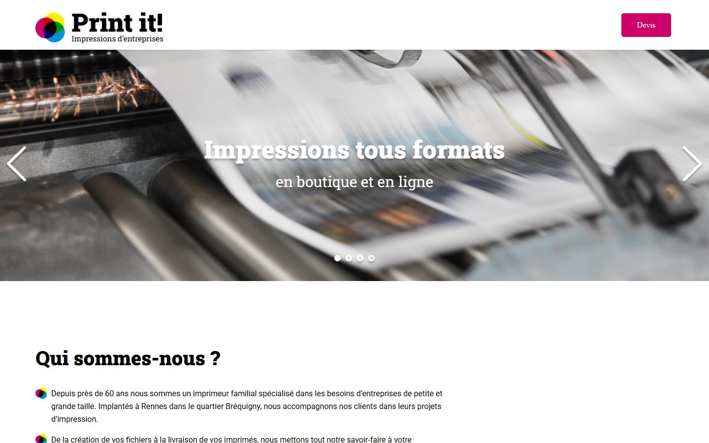
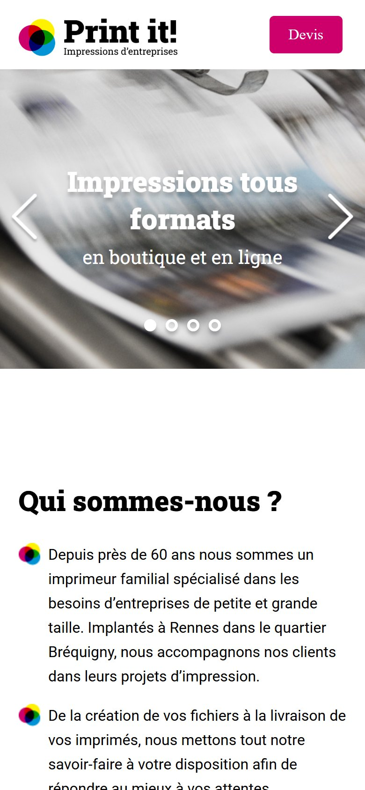

# Print it!

A JavaScript image carousel added to an existing one-page website of a printing company.

**Live site:** https://idento.github.io/Print-it/

| Desktop | Mobile |
| --- | --- |
|  |  |

## What was done

The page (layout, texts, styles) already existed. My part is the **banner carousel in vanilla JavaScript**:

- slides described in a data array (image and caption);
- previous and next arrows;
- one dot per slide, generated from the data, with the current slide highlighted;
- infinite loop: after the last slide it goes back to the first, and the other way round.

Fixes made later, in 2026:

- the carousel image path was relative to the wrong folder and broke once the site was published in a sub-folder (`../assets` changed to `./assets`);
- the page overflowed horizontally on phones: images are now constrained to their container and the sections stack below 900 px.
- the photos weighed 3.6 MB in total: recompressed to about 0.4 MB with no visible loss, and the last slide converted from PNG to JPEG.

## Lighthouse

Measured on the live site on October 21, 2026, after the 2026 fixes (Lighthouse 13.5, median of 3 runs):

| | Performance | Accessibility | Best practices | SEO |
| --- | --- | --- | --- | --- |
| Mobile | 88 | 92 | 92 | 91 |
| Desktop | 98 | 92 | 96 | 91 |

## Stack

HTML, CSS, vanilla JavaScript. Deployed on GitHub Pages with GitHub Actions.

## Run locally

Open `index.html` in a browser, or serve the folder with any static server.
